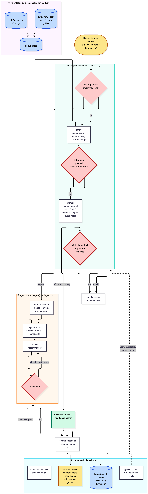

# 🎧 TuneScout RAG: Plain-Language Music Recommendations

TuneScout RAG recommends songs from a small catalog based on a request you type in plain words, like *"mellow songs for studying on a rainy day."* It first looks up the songs and the genre/mood notes that best match your request. Then it asks an LLM (Google Gemini) to choose and explain recommendations **using only what it looked up**. Every pick cites a real song from the catalog, and the system checks the LLM's answer before showing it to you.

**Why it matters:** Recommenders often feel like black boxes, and LLMs can confidently make things up. TuneScout shows one way to get the friendliness of an LLM without giving up trust. The answers are grounded in real data, every pick is explained, invented songs are caught and removed, and the system still works without the LLM.

---

## Original Project (Module 3): Music Recommender Simulation

This project extends my **Music Recommender Simulation** ([original repo](https://github.com/vforvian/ai110-module3show-musicrecommendersimulation-starter)). The original was a rule-based, content-based recommender called **TuneScout 1.0**. It scored each of 20 songs against a fixed taste profile (genre, mood, target energy, and acoustic preference) using weighted points, and returned the top 5 with a "Why" list for each pick. It worked, but users had to type exact labels and numbers, and it treated similar moods like "chill" and "relaxed" as completely unrelated.

---

## Architecture Overview



> Diagram source: [`diagrams/architecture.mmd`](diagrams/architecture.mmd)

The system has two stages:

1. **Indexing (runs once at startup).** Each row of `data/songs.csv` becomes a short text description of the song (genre, mood, energy, tempo, and so on). The genre/mood guides in `data/knowledge/` are split into chunks. Everything is indexed with **TF-IDF**, so the retriever can search it.
2. **RAG pipeline (runs for every request).**
   - An **input guardrail** rejects empty or overly long requests.
   - The **retriever** finds the top-matching songs and guide notes.
   - A **relevance guardrail** stops the pipeline if nothing matches well. The app then says so honestly instead of guessing.
   - The **prompt builder** gives Gemini the request plus *only* the retrieved songs and notes, and tells it to recommend from that list.
   - An **output guardrail** checks that every recommended song ID exists in the retrieved set and removes any invented song.
   - If Gemini is unavailable (no API key, network error), the app **falls back to the original Module 3 rule-based ranking**, so it never crashes.

**Logging:** every step is logged to `logs/tunescout.log`: the request, the retrieved IDs and their scores, any picks that were removed, and whether the fallback was used.

**Human and testing checks:**
- Users can verify each pick against the cited song's features.
- Developers review the logs.
- `pytest` covers the document builder, retrieval, guardrails, and fallback.

---

## Setup Instructions

**Requirements:** Python 3.10+ and a free [Google Gemini API key](https://aistudio.google.com/apikey). The app still runs without a key, but uses the rule-based fallback.

1. **Clone the repo**

   ```bash
   git clone https://github.com/vforvian/applied-ai-system-project.git
   cd applied-ai-system-project
   ```

2. **Create and activate a virtual environment**

   ```bash
   python -m venv .venv
   source .venv/bin/activate      # Mac / Linux
   .venv\Scripts\activate         # Windows
   ```

3. **Install dependencies**

   ```bash
   python -m pip install --upgrade pip
   pip install -r requirements.txt
   ```

   Upgrading pip first matters. An older pip may try to build `cryptography` from source and fail.

4. **Add your API key.** Copy the example file and paste your key into `.env`:

   ```bash
   cp .env.example .env
   # then edit .env:  GEMINI_API_KEY=your-key-here
   ```

   `.env` is listed in `.gitignore`, so your key is never committed.

5. **Run the app**

   ```bash
   python -m src.main "mellow songs for studying on a rainy day"
   ```

   - `python -m src.main` with no request starts an interactive prompt.
   - `-k 5` returns 5 songs instead of 3.
   - `python -m src.main --legacy` runs the original Module 3 demo.
   - `python -m src.main --agent --trace "NOT sad, something happy"` uses the plan → act → check agent and prints its reasoning trace.

6. **Run the tests**

   ```bash
   pytest -rx      # -rx also lists the known-limitation (xfail) tests
   ```

7. **Run the evaluation harness** (optional)

   ```bash
   python -m src.evaluate --offline       # retrieval + guardrails, no API calls
   python -m src.evaluate --only style    # baseline vs. specialized prompt (16 calls)
   python -m src.evaluate --only agent    # plain RAG vs. agent on hard cases (9 calls)
   ```

   Reports are written to `reports/`. Free-tier Gemini keys allow about **20 requests per model per day**, so run the live sections separately. You can also point a section at another model, e.g. `GEMINI_MODEL=gemini-3.5-flash-lite`.

---

## Execution Evidence

Everything below is copied from real runs. Nothing is mocked up. The committed `.txt` logs in [`reports/`](reports/) are the raw terminal output.

| What is being shown | Where |
|---|---|
| **End-to-end runs** (command → input → AI output) | [Sample Interactions](#sample-interactions), Examples 1, 2 and 4 (live Gemini) |
| **AI feature behavior** | RAG: Examples 1–2 show the matched guide notes and grounded reasons. Agent: Example 5 shows the full reasoning trace. |
| **Guardrails** | Example 3 (no match) and [Guardrail runs](#guardrail-and-fallback-runs) below (empty input, no match, no API key) |
| **Reliability / evaluation** | [Test suite output](#test-suite-output), [Evaluation harness output](#evaluation-harness-output), and the [Testing Summary](#testing-summary) tables |
| **Logging** | [Log excerpt](#log-excerpt) below |

### Test suite output

Full log: [`reports/pytest_output.txt`](reports/pytest_output.txt)

```
$ pytest -q -rx
.........................................xxxx..                          [100%]
=========================== short test summary info ============================
XFAIL tests/test_rag.py::test_negation_is_understood - TF-IDF ignores negation: 'NOT sad' still matches sad songs
XFAIL tests/test_rag.py::test_reasonable_requests_outside_guide_vocabulary[something to fall asleep to] - Words missing from songs + guides get no match (e.g. 'asleep', 'funeral')
XFAIL tests/test_rag.py::test_reasonable_requests_outside_guide_vocabulary[music for a funeral] - Words missing from songs + guides get no match (e.g. 'asleep', 'funeral')
XFAIL tests/test_rag.py::test_artist_similarity_request - Catalog has no real artists, so artist-similarity requests can't match
======================== 43 passed, 4 xfailed in 0.48s =========================
```

### Evaluation harness output

Full log: [`reports/evaluate_offline_output.txt`](reports/evaluate_offline_output.txt). Live sections: [`reports/eval_report_style.md`](reports/eval_report_style.md), [`reports/eval_report_agent.md`](reports/eval_report_agent.md).

```
$ python -m src.evaluate --offline

=== 1. RAG enhancement: songs only vs. songs + guides ===
  Request                                       Songs only (best score)  Songs + guides (best score)
  "mellow songs for studying on a rainy day"    FAIL (0.00)              PASS (0.24)
  "something relaxed and chill, kind of jazzy"  PASS (0.23)              PASS (0.20)
  "songs to get pumped up at the gym"           PASS (0.30)              PASS (0.24)
  "sad breakup songs"                           PASS (0.29)              PASS (0.31)
  "date night slow jams"                        FAIL (0.27)              PASS (0.17)
  "beach vacation vibes"                        FAIL (0.00)              PASS (0.22)
  "night drive through the city"                PASS (0.35)              PASS (0.30)
  "rnb"                                         PASS (0.30)              PASS (0.24)
Retrieval hit@3: songs only 5/8 -> songs + guides 8/8

=== 2. Guardrails ===
  Input                            Expected       Got            Result
  ''                               invalid_input  invalid_input  PASS
  '   '                            invalid_input  invalid_input  PASS
  '1234 !!!'                       invalid_input  invalid_input  PASS
  'xxxxxxxxxxxx...'                invalid_input  invalid_input  PASS
  'Gregorian chant with bagpipes'  no_match       no_match       PASS
  'asdf qwerty'                    no_match       no_match       PASS
Guardrails: 6/6 passed
```

```
$ GEMINI_MODEL=gemini-3.5-flash-lite python -m src.evaluate --only style
=== 3. Specialization: baseline prompt vs. few-shot house style ===
  Prompt       #1 pick correct  Avg words/reason  <=20 words  Quotes a number  No hype words  Echoes request  Avg confidence
  baseline     7/8              18.9              71%         18%              65%            82%             0.92
  specialized  7/8              14.4              100%        100%             100%           100%            0.92

$ GEMINI_MODEL=gemini-3.1-flash-lite python -m src.evaluate --only agent
=== 4. Agent: plain RAG vs. plan/act/check agent ===
  Hard request                   Plain RAG                           Agent
  "NOT sad, something happy"     PASS: Sunrise City, Rooftop Lights  PASS: Sunrise City, Rooftop Lights, Fuego Lento
  "something to fall asleep to"  FAIL: no_match                      PASS: Rain on Glass Harbor, Spacewalk Thoughts
  "music for a funeral"          FAIL: no_match                      FAIL: Rain on Glass Harbor, Last Bus Home, Library Rain
Hard cases: plain RAG 1/3 -> agent 2/3
```

### Guardrail and fallback runs

Full log: [`reports/fallback_and_guardrails_output.txt`](reports/fallback_and_guardrails_output.txt). This run has the API key removed on purpose, to show the system still works without Gemini. The output below is trimmed; the full text is in the log.

```
$ GEMINI_API_KEY= python -m src.main "mellow songs for studying on a rainy day"
(No GEMINI_API_KEY found: running in rule-based fallback mode.)
================================================================
 Request: "mellow songs for studying on a rainy day"
----------------------------------------------------------------
 Mode: Rule-based fallback
 Matched guide notes: mood:chill, genre:lofi, mood:relaxed
 Retrieval score: 0.24
 Note: AI unavailable (no API key); used rule-based ranking with profile {'mood': 'chill', 'genre': 'lofi', 'energy': 0.4}.
----------------------------------------------------------------
 1. Midnight Coding  (LoRoom)   [song id 2]
    lofi · chill · energy 0.42
    Why: genre match: lofi (+1.0); mood match: chill (+1.5); energy 0.42 vs. target 0.40 (+3.92)
 2. Library Rain  (Paper Lanterns)   [song id 4]
 3. Spacewalk Thoughts  (Orbit Bloom)   [song id 6]
================================================================

$ GEMINI_API_KEY= python -m src.main "   "
 Request: "   "
 ⚠  Please describe the music you want, e.g. 'calm songs for studying'.

$ GEMINI_API_KEY= python -m src.main "Gregorian chant with bagpipes"
 Request: "Gregorian chant with bagpipes"
 ⚠  I couldn't find anything in the catalog that matches that request.
```

### Log excerpt

From `logs/tunescout.log`. This file is git-ignored, so the excerpt is copied here. Long lines are shortened with `…`. It shows a successful answer, each guardrail, and real Gemini outages being retried and then handled by the fallback:

```
INFO    src.rag: Request 'mellow songs for studying on a rainy day' | guides=[('mood:chill', 0.36), ('genre:lofi', 0.252), ('mood:relaxed', 0.213)] | songs=[(9, 0.236), (2, 0.212), (7, 0.209), (4, 0.197), …]
INFO    src.rag: Answer: ids=[4, 9, 2] confidence=0.95 dropped=[]
INFO    src.rag: Rejected request '   ': Please describe the music you want, e.g. 'calm songs for studying'.
INFO    src.rag: No match (best score 0.000 < 0.08)
WARNING src.rag: Fallback used: no API key | profile={'mood': 'chill', 'genre': 'lofi', 'energy': 0.4}
WARNING src.llm: Gemini attempt 1/3 failed (model=gemini-3.8-flash): 503 UNAVAILABLE. … high demand …
WARNING src.llm: Gemini attempt 2/3 failed (model=gemini-3.8-flash): 503 UNAVAILABLE. …
WARNING src.llm: Gemini attempt 3/3 failed (model=gemini-3.8-flash): 503 UNAVAILABLE. …
WARNING src.rag: Fallback used: Gemini request failed (503) | profile={'mood': 'chill', 'genre': 'lofi', 'energy': 0.4}
```

---

## Sample Interactions

These are real outputs, recorded with `gemini-3.5-flash`. Gemini's wording varies a little from run to run.

**Example 1: A normal request.** The mood guide maps "mellow" and "studying" to *chill* and *lofi*.

```
$ python -m src.main "mellow songs for studying on a rainy day"

================================================================
 Request: "mellow songs for studying on a rainy day"
----------------------------------------------------------------
 Mode: AI (Gemini + retrieval)
 Matched guide notes: mood:chill, genre:lofi, mood:relaxed
 Retrieval score: 0.24   AI confidence: 0.95
----------------------------------------------------------------

 1. Library Rain  (Paper Lanterns)   [song id 4]
    lofi · chill · energy 0.35
    Why: This lo-fi track features a chill mood, low energy (0.35), and a slow 72 BPM tempo, making it a perfectly cozy backdrop for studying on a rainy day.

 2. Focus Flow  (LoRoom)   [song id 9]
    lofi · focused · energy 0.40
    Why: Designed for a focused mood with lo-fi beats, low energy (0.40), and an organic acoustic sound, this track helps maintain study flow.

 3. Midnight Coding  (LoRoom)   [song id 2]
    lofi · chill · energy 0.42
    Why: A mellow lo-fi song with a chill mood, slow tempo (78 BPM), and soft organic instrumentation ideal for background study music.

 Here are three mellow lo-fi tracks with slow tempos and low energy, perfect for staying focused on a rainy day.

================================================================
```

**Example 2: A similar-mood request (the case Module 3 got wrong).** Module 3 gave *Coffee Shop Stories* no mood credit, because "relaxed" ≠ "chill". Now it ranks #1.

```
$ python -m src.main "something relaxed and chill, kind of jazzy"

================================================================
 Request: "something relaxed and chill, kind of jazzy"
----------------------------------------------------------------
 Mode: AI (Gemini + retrieval)
 Matched guide notes: mood:chill, mood:relaxed, mood:carefree
 Retrieval score: 0.20   AI confidence: 0.95
----------------------------------------------------------------

 1. Coffee Shop Stories  (Slow Stereo)   [song id 7]
    jazz · relaxed · energy 0.37
    Why: It is a jazz track with a relaxed mood, low energy, and soft acoustic sound that perfectly matches your request for something relaxed and jazzy.

 2. Midnight Coding  (LoRoom)   [song id 2]
    lofi · chill · energy 0.42
    Why: This song features a chill mood with low energy and a calm, soft lo-fi acoustic sound for a laid-back feel.

 3. Library Rain  (Paper Lanterns)   [song id 4]
    lofi · chill · energy 0.35
    Why: With a chill mood, slow tempo, and quiet acoustic sound, this lo-fi track offers a soothing, relaxed atmosphere.

 Here are the best relaxed and chill tracks featuring smooth jazz and cozy lo-fi vibes.

================================================================
```

**Example 3: The relevance guardrail (no good match in the catalog).** Gemini is never called, so it has no chance to invent an answer.

```
$ python -m src.main "Gregorian chant with bagpipes"

================================================================
 Request: "Gregorian chant with bagpipes"
----------------------------------------------------------------
 ⚠  I couldn't find anything in the catalog that matches that request.
================================================================
```

**Example 4: Gemini fixes a retrieval mistake.** TF-IDF can't handle "NOT", so the top retrieved songs were sad. Gemini read the request, skipped those songs, and picked the happy songs from the candidate list.

```
$ python -m src.main "NOT sad, something happy"
 Mode: AI (Gemini + retrieval)
 Matched guide notes: genre:blues, mood:melancholic, mood:sad
 Retrieval score: 0.30   AI confidence: 0.95

 1. Sunrise City  (Neon Echo)   [song id 1]
    pop · happy · energy 0.82
    Why: It features an explicitly happy mood, high energy, fast tempo, and a bright, positive feel perfect for turning around a sad mood.

 2. Rooftop Lights  (Indigo Parade)   [song id 10]
    indie pop · happy · energy 0.76
    Why: It offers a happy mood with high energy, upbeat danceability, and a bright, positive vibe.
```

**Example 5: Agent mode with its reasoning trace.** The planner turns "NOT sad" into an avoid list and an energy range. The tools remove two songs that break the plan before Gemini sees them, and the check step confirms that no pick breaks the plan.

```
$ python -m src.main --agent --trace "NOT sad, something happy"

--- agent trace ---
1. [request] {"text": "NOT sad, something happy"}
2. [plan] {"search_query": "happy upbeat cheerful positive", "moods": ["happy", "carefree", "euphoric", "playful"], "genres": [], "avoid_moods": ["sad", "melancholic", "dark", "moody"], "energy_min": 0.5, "energy_max": 1.0, "reasoning": "The listener explicitly requested happy music and rejected sad tones. ..."}
3. [tool: search_catalog] {"input": "happy upbeat cheerful positive", "output": [[1, "Sunrise City", 0.26], [10, "Rooftop Lights", 0.24], [19, "Island Time Radio", 0.23], [18, "Fuego Lento", 0.22], [5, "Gym Hero", 0.19], [15, "Neon Cathedral", 0.19], [6, "Spacewalk Thoughts", 0.12], [7, "Coffee Shop Stories", 0.12]], "guides": ["mood:happy"]}
4. [tool: find_by_label] {"input": {"moods": ["happy", "carefree", "euphoric", "playful"], "genres": []}, "output": [[1, "Sunrise City"], [10, "Rooftop Lights"], [15, "Neon Cathedral"], [18, "Fuego Lento"], [19, "Island Time Radio"]]}
5. [tool: apply_constraints] {"removed_ids": [6, 7], "kept": [[1, "Sunrise City"], [10, "Rooftop Lights"], [19, "Island Time Radio"], [18, "Fuego Lento"], [5, "Gym Hero"], [15, "Neon Cathedral"]]}
6. [recommend] {"attempt": 1, "picks": [[1, "Sunrise City"], [10, "Rooftop Lights"], [18, "Fuego Lento"]], "confidence": 0.95, "dropped_ids": []}
7. [check] {"attempt": 1, "violations": "none"}
8. [answer] {"ids": [1, 10, 18]}

================================================================
 Request: "NOT sad, something happy"
----------------------------------------------------------------
 Mode: AI (Gemini + retrieval)
 Matched guide notes: mood:happy
 Retrieval score: 0.26   AI confidence: 0.95
----------------------------------------------------------------

 1. Sunrise City  (Neon Echo)   [song id 1]
    pop · happy · energy 0.82
    Why: Happy pop track featuring 0.82 energy and 118 BPM to keep things bright and upbeat.

 2. Rooftop Lights  (Indigo Parade)   [song id 10]
    indie pop · happy · energy 0.76
    Why: Bright indie pop with a happy mood, 0.76 energy, and 124 BPM tempo.

 3. Fuego Lento  (Los Faroles)   [song id 18]
    latin · playful · energy 0.84
    Why: Playful latin song with 0.84 energy and 104 BPM offers a happy feel.

 Here are bright, upbeat tracks to lift your mood.

================================================================
```

**Fallback mode (no API key, or Gemini down).** The same request is ranked by the Module 3 scorer, using a profile built from the retrieved guides:

```
 Mode: Rule-based fallback
 Note: AI unavailable (no API key); used rule-based ranking with profile {'mood': 'chill', 'genre': 'lofi', 'energy': 0.4}.
 1. Midnight Coding  (LoRoom)   [song id 2]
    Why: genre match: lofi (+1.0); mood match: chill (+1.5); energy 0.42 vs. target 0.40 (+3.92)
```

---

## Design Decisions

| Decision | Why | Trade-off |
|---|---|---|
| **RAG instead of letting the LLM recommend freely** | Gemini can only recommend songs that actually exist in the catalog, and every pick cites a song ID. | Recommendations are limited to the 20-song catalog. |
| **TF-IDF retrieval (scikit-learn) instead of embeddings** | Free, runs offline, needs no second API key, and gives the **same results every run**, which makes testing reproducible. | It matches words, not meaning. The genre/mood guides make up for this by linking similar words (e.g. "chill ≈ relaxed ≈ focused"). |
| **Songs turned into text documents** | Lets one retriever search both song data and written guides. | Numbers like energy 0.35 are turned into words ("low energy"), which loses some precision. |
| **Three guardrails (input, relevance, output)** | Each one targets a different failure: bad input, no real match, or an invented song. | More code paths to test, and the relevance threshold had to be tuned by hand. |
| **Module 3 scorer kept as a fallback** | The app still works with no key or no network, and the original project stays part of the system. | Fallback answers are less flexible: they need structured preferences, not plain language. |
| **Google Gemini** | Has a free tier and is fast enough for a CLI app. | Depends on an external service, and output wording can vary between runs. |

---

## Testing Summary

**Result: 43 of 43 tests pass, plus 4 known-limitation tests that are expected to fail** (`pytest -rx`). Retrieval found an expected song in the top 3 for **8 of 8** benchmark requests. With live Gemini, the **#1 pick was an expected song for 8 of 8 requests**, with **0 invented songs** and an **average confidence of 0.92**. All three guardrails caught every failure I forced: invented songs, broken JSON, API errors, and empty or nonsense input. Retrieval struggles with **negation** ("NOT sad") and with **words that aren't in the guides** ("fall asleep", "funeral"). Gemini fixed the negation case on its own (see Example 4).

### How reliability is measured

| Method | What it checks | Where |
|---|---|---|
| **Automated tests** (47 total) | Document building, retrieval quality, all 3 guardrails, prompt grounding, fallback | `tests/test_rag.py`, `tests/test_agent.py`, `tests/test_recommender.py` |
| **Fake LLM in tests** | Forces Gemini failures (invented IDs, bad JSON, errors) offline and deterministically | `FakeGenerator` in `tests/test_rag.py` |
| **Confidence scoring** | Gemini rates its confidence (0–1) in each answer, shown next to the TF-IDF retrieval score | `RecommendationResult.confidence`, CLI output |
| **Logging & error handling** | Every request, retrieved IDs and scores, dropped picks, and fallback reasons | `logs/tunescout.log` |

### Retrieval benchmark (golden set)

Each request should return at least one expected song in the top 3 retrieved results.

| Request | Expected song(s) | Top 3 retrieved | Result |
|---|---|---|---|
| "mellow songs for studying on a rainy day" | Library Rain, Midnight Coding, Focus Flow | Focus Flow, Midnight Coding, Coffee Shop Stories | ✅ Pass |
| "something relaxed and chill, kind of jazzy" | Coffee Shop Stories | Coffee Shop Stories, Midnight Coding, Library Rain | ✅ Pass |
| "songs to get pumped up at the gym" | Gym Hero, Storm Runner | Gym Hero, Storm Runner, Sunrise City | ✅ Pass |
| "sad breakup songs" | Last Bus Home | Last Bus Home, Rain on Glass Harbor, Underground Static | ✅ Pass |
| "date night slow jams" | Velvet Hours | Velvet Hours, Night Drive Loop, Underground Static | ✅ Pass |
| "beach vacation vibes" | Island Time Radio | Island Time Radio, Coffee Shop Stories, Sunrise City | ✅ Pass |
| "night drive through the city" | Night Drive Loop | Night Drive Loop, Sunrise City, Velvet Hours | ✅ Pass |
| "rnb" | Velvet Hours | Velvet Hours, Concrete Crown, Last Bus Home | ✅ Pass |

### Live Gemini run (`gemini-3.5-flash`, baseline prompt, same 8 requests)

| Request | Gemini's picks | #1 pick expected? | Confidence | Invented songs removed |
|---|---|---|---|---|
| "mellow songs for studying on a rainy day" | Library Rain, Focus Flow, Midnight Coding | ✅ | 0.95 | 0 |
| "something relaxed and chill, kind of jazzy" | Coffee Shop Stories, Midnight Coding, Library Rain | ✅ | 0.95 | 0 |
| "songs to get pumped up at the gym" | Gym Hero, Storm Runner, Neon Cathedral | ✅ | 0.95 | 0 |
| "sad breakup songs" | Last Bus Home, Rain on Glass Harbor | ✅ | 0.85 | 0 |
| "date night slow jams" | Velvet Hours | ✅ | 0.95 | 0 |
| "beach vacation vibes" | Island Time Radio, Fuego Lento, Sunrise City | ✅ | 0.95 | 0 |
| "night drive through the city" | Night Drive Loop, Underground Static, Velvet Hours | ✅ | 0.95 | 0 |
| "rnb" | Velvet Hours, Concrete Crown | ✅ | 0.85 | 0 |

Gemini returned **fewer than 3 picks** when the remaining candidates didn't fit; for example, "date night" got only Velvet Hours. Prompt rule 4 asks for this. Its confidence was lower (0.85) on two of the requests where it returned fewer than 3 picks. That suggests the confidence score tracks how many good matches the catalog actually has.

### Guardrail and failure tests

| Test input | Evaluation criteria | Result |
|---|---|---|
| Empty, whitespace, `None`, "1234 !!!", 301 characters | Rejected with a helpful message; LLM never called | ✅ Pass |
| "Gregorian chant with bagpipes", "asdf qwerty" | "No match" message; LLM never called | ✅ Pass |
| LLM returns song ID 999 (doesn't exist) | ID 999 removed, real picks kept | ✅ Pass |
| LLM returns Iron Tide for a calm request (real song, not retrieved) | Removed, because only retrieved songs are allowed | ✅ Pass |
| LLM returns only invented songs, bad JSON, a JSON list, or an API error | Falls back to Module 3 ranking with 3 real songs | ✅ Pass |
| No `GEMINI_API_KEY` | Fallback mode; "mellow studying" returns only lofi, ambient or jazz | ✅ Pass |
| LLM confidence of 1.7 | Clamped to 1.0 | ✅ Pass |
| "chill" (the Module 3 bug) | Mood guide expands to "relaxed" and finds Coffee Shop Stories | ✅ Pass |
| "NOT sad, something happy" | Top song shouldn't be sad | ❌ Fail (expected): Last Bus Home ranks #1 |
| "something to fall asleep to", "music for a funeral" | Should find calm or sad songs | ❌ Fail (expected): "no match" |
| "songs like Taylor Swift" | Should find similar songs | ❌ Fail (expected): the catalog has no real artists |

### What I learned from testing

- **A probe found a bug that tests written to pass would have missed.** The word "songs" matched the pop guide's "sing-along songs", which pulled pop into "sad breakup songs". Adding music-specific stop words (`songs`, `music`, `vibes`, …) fixed it.
- **Writing down failing tests is more honest than leaving them out.** The 4 `xfail` tests document real limits of keyword retrieval (negation and vocabulary gaps). If a later change fixes one, `strict=True` makes the test fail, so the fix gets noticed.
- **A fake LLM made the guardrails testable.** Real Gemini almost never invents a song ID on purpose, so the only reliable way to prove the output guardrail works is to force that failure.
- **The fallback and retries were tested against real outages, not just fakes.** During the live run, `gemini-2.5-flash` returned **404 (retired)** and `gemini-3.8-flash` returned **503 (overloaded)** three times in a row. Both times the app logged the error and returned rule-based picks instead of crashing. I then made the model configurable (`GEMINI_MODEL`) and switched the default to `gemini-3.5-flash`.

---

## Stretch Features

All four optional features build on the RAG pipeline. Every number below comes from the evaluation harness ([`src/evaluate.py`](src/evaluate.py)). Its reports are committed in [`reports/`](reports/).

### 1. RAG enhancement: a second data source (custom mood & genre guides)

Retrieval uses **two sources**: the song catalog (`data/songs.csv`) and 33 hand-written mood and genre guides (`data/knowledge/`). The guides do two jobs:
- **Expand the request:** "mellow" also searches for *chill, relaxed, low energy*.
- **Give Gemini context:** the guide notes go into the prompt, so it can interpret the request.

**Before/after** (`TuneScoutRAG(use_guides=False)` vs. `True`). A request counts as a pass only if it isn't rejected as "no match":

| Request | Songs only (best score) | Songs + guides (best score) |
|---|---|---|
| "mellow songs for studying on a rainy day" | ❌ no match (0.00) | ✅ Focus Flow, Midnight Coding… (0.24) |
| "something relaxed and chill, kind of jazzy" | ✅ (0.23) | ✅ (0.20) |
| "songs to get pumped up at the gym" | ✅ (0.30) | ✅ (0.24) |
| "sad breakup songs" | ✅ (0.29) | ✅ (0.31) |
| "date night slow jams" | ❌ Night Drive Loop, no r&b (0.27) | ✅ Velvet Hours (0.17) |
| "beach vacation vibes" | ❌ no match (0.00) | ✅ Island Time Radio (0.22) |
| "night drive through the city" | ✅ (0.35) | ✅ (0.30) |
| "rnb" | ✅ (0.30) | ✅ (0.24) |

**Retrieval hit@3: 5/8 → 8/8.** Without the guides, the words "mellow", "studying", "beach" and "date night" don't appear in any song, so retrieval fails or finds the wrong songs. The guides connect those everyday words to catalog labels. They also feed Gemini the context it uses in its reasons: for example, "rainy day" → *chill*.

### 2. Specialization: a few-shot "house style" prompt

The specialized prompt adds four style rules and **two example answers**. The examples use requests and songs that aren't in the evaluation set, so the model can't just copy them. The rules:
- At most 20 words.
- Quote an exact energy or BPM number.
- Echo a word from the request.
- No hype words.

Measured on the 8 golden requests (`python -m src.evaluate --only style`, `gemini-3.5-flash-lite`):

| Prompt | #1 pick correct | Avg words / reason | ≤ 20 words | Quotes a number | No hype words | Echoes request | Avg confidence |
|---|---|---|---|---|---|---|---|
| Baseline | 7/8 | 18.9 | 71% | 18% | 65% | 82% | 0.92 |
| **Specialized (few-shot)** | **7/8** | **14.4** | **100%** | **100%** | **100%** | **100%** | 0.92 |

The output is measurably different: reasons are shorter, every reason quotes a real number from the catalog, and there are no "perfect"/"ideal" filler words. Accuracy is unchanged. Here are two reasons for the same song (*Sunrise City*) on the same request ("NOT sad, something happy"), both from `gemini-3.5-flash`:
- **Baseline (24 words, hype word, no numbers):** *"It features an explicitly happy mood, high energy, fast tempo, and a bright, positive feel perfect for turning around a sad mood."*
- **Specialized (14 words, quotes 0.82 and 118 BPM):** *"Happy pop track featuring 0.82 energy and 118 BPM to keep things bright and upbeat."*

The specialized style is the default. `TuneScoutRAG(style="baseline")` turns it off.

### 3. Agentic workflow: plan → act → recommend → check → retry

`python -m src.main --agent --trace "<request>"` runs [`src/agent.py`](src/agent.py), which works in five steps:
1. **Plan:** Gemini writes a search plan: search words, moods to look for, moods to **avoid**, and an **energy range**.
2. **Act:** Python tools carry it out: `search_catalog`, `find_by_label`, and `apply_constraints`.
3. **Recommend:** Gemini picks from the remaining candidates only.
4. **Check:** Python checks every pick against the plan.
5. **Retry:** if a pick breaks the plan, Gemini gets feedback and tries once more.

On the hard cases that plain retrieval gets wrong (`--only agent`, `gemini-3.1-flash-lite`):

| Hard request | Rule | Plain RAG | Agent |
|---|---|---|---|
| "NOT sad, something happy" | no sad/melancholic picks | ✅ | ✅ |
| "something to fall asleep to" | all energy < 0.45 | ❌ no match | ✅ Rain on Glass Harbor, Spacewalk Thoughts |
| "music for a funeral" | energy < 0.5 and valence < 0.6 | ❌ no match | ❌ third pick had valence 0.60 |

**Plain RAG 1/3 → Agent 2/3.** The plan format can express moods and energy but not "not upbeat" (valence), which is why "funeral" still fails. The reasoning traces are in [`ai_interactions.md`](ai_interactions.md) and [`reports/agent_traces.md`](reports/agent_traces.md).

### 4. Test harness: `python -m src.evaluate`

One command runs the system on the predefined inputs in [`src/eval_cases.py`](src/eval_cases.py) and prints pass/fail tables plus a summary. The four sections are the three comparisons above and a guardrail check. Example summary:

```
=== SUMMARY ===
 - Retrieval hit@3: songs only 5/8 -> songs + guides 8/8
 - Guardrails: 6/6 passed
 - Live sections use model: gemini-3.5-flash-lite
 - Style: reasons quoting a number 18% -> 100%, <=20 words 71% -> 100%, no hype words 65% -> 100%; #1 pick correct 7/8 -> 7/8
```

**A lesson the harness taught me:** my first full run hit Gemini's free-tier limit (20 requests/day per model) partway through. The run reported fallback answers as if they were Gemini's, which made the specialized prompt look like it scored 0/8. I changed the harness so requests that fall back are marked **SKIPPED**, the report gets a warning, and each live section can run on its own.

---

## Reflection

This project taught me that a trustworthy AI system has more to do with the structure around the model than with the model itself. Gemini alone could have written confident, friendly recommendations for songs that don't exist. Making it retrieve first, limiting it to what it retrieved, and checking its answer afterward is what made those recommendations worth trusting. I also learned that a passing test suite doesn't mean the system works. My worst bug, the word "songs" pulling pop music into a sad request, only showed up when I tried requests I hadn't planned for, and the real Gemini outages tested my fallback better than any of my fake failures did. For problem-solving, the biggest change for me was treating failures as something to write down, not hide. Adding tests that are expected to fail for the cases my system can't handle made its limits clear, and it showed me what to improve next.

> The full responsible-AI reflection (limitations, misuse, AI collaboration) is in the [model card](model_card.md).

---

## Project Structure

```
├── assets/              # architecture diagram PNG
├── data/
│   ├── songs.csv        # 20-song catalog
│   └── knowledge/       # genre & mood guides used for retrieval
├── diagrams/
│   └── architecture.mmd # Mermaid source for the system diagram
├── logs/                # runtime logs (git-ignored)
├── src/
│   ├── main.py          # CLI entry point + logging setup
│   ├── rag.py           # retrieval, prompt (+ few-shot style), guardrails, fallback
│   ├── agent.py         # plan -> act -> check -> retry agent
│   ├── evaluate.py      # evaluation harness
│   ├── eval_cases.py    # predefined inputs shared by tests + harness
│   ├── llm.py           # Gemini wrapper (retries, configurable model)
│   └── recommender.py   # Module 3 rule-based scorer (used as fallback)
├── reports/             # harness reports + agent reasoning traces
├── tests/
│   ├── test_rag.py          # RAG reliability tests
│   ├── test_agent.py        # agent chain, constraints, retry
│   └── test_recommender.py  # original Module 3 tests
├── ai_interactions.md   # agent reasoning traces (stretch feature)
├── .env.example         # copy to .env and add GEMINI_API_KEY
├── model_card.md        # responsible-AI reflection & limitations
├── pytest.ini
└── requirements.txt
```
